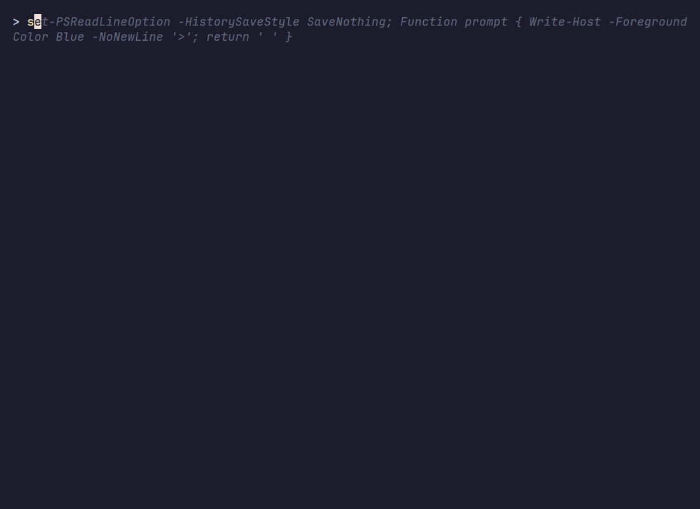

# Filling data

```text
schemify fill <schema.json> [-o file] [-f json|python|javascript]
```

`fill` reads a schema, checks that it is a valid JSON Schema, and asks for one value
matching it: usually an object, one question per property, in schema order.



## How each value is asked

The prompt depends on the property's **kind**: `enum` when it has choices, else its
`format` (`date`, `date-time`), else its `type`.

| Kind | Prompt | Example |
|------|--------|---------|
| `string` | text | `? Full name: Rama Hasan` |
| `integer` | text, read as a whole number | `? Quantity: 3` |
| `number` | text, read as a number | `? Unit price (USD): 24.5` |
| `date` | text, an ISO date | `? Issue date: 2026-11-26` |
| `date-time` | text, an ISO date and time | `? Arrival: 2026-12-01T09:30:00+03:00` |
| `boolean` | yes / no | `? Paid: No` |
| `enum` | pick from a list | `? Status: sent` |
| `array` | one item at a time, see [Arrays](#arrays) | |
| `object` | its properties, one by one | |

The question is the property's `title` (or its path, like `customer.name`, when it has
none), followed by its `description` in brackets.

## Checked as you type

Every answer is parsed, then checked against the property's schema. A wrong answer is
refused with the reason, and you type again:

```text
? Invoice number (INV- and 4 digits): INV-12
  >> 'INV-12' does not match '^INV-[0-9]{4}$'
? Invoice number (INV- and 4 digits): INV-0042
? Issue date: 2026-11-31
  >> day is out of range for month
? Issue date: 2026-11-26
? Unit price (USD): 3.999
  >> 3.999 is not a multiple of 0.01
? Unit price (USD): 3.75
```

Lengths, patterns, ranges, multiples, choices and formats (`date`, `email`, `uuid`, ...)
are all checked. When the last question is answered, the whole value is checked once
more against the whole schema, which catches keywords no prompt asks about (such as
`allOf` or `dependentRequired`).

## Required and optional

| Property | Text prompt | Yes/no, choice, array, object |
|----------|-------------|-------------------------------|
| required | an empty answer is refused: `This value is required` | asked directly |
| optional | leave it **empty** to skip it | first asks `Add '<label>'?` |

A skipped property is **left out** of the data, not written as `null`:

```text
? First name: Omar
? Last name: Ali
? Age (In whole years):
```

```json
{"first": "Omar", "last": "Ali"}
```

## Defaults

A `default` is offered as the starting answer:

- text prompts start with it already typed: press ++enter++ to keep it, or edit it;
- yes/no prompts start on it;
- choice prompts start with it selected.

In the invoice, `Quantity` starts at `1` and `Status` on `draft`.

## Dates and times

| Kind | You type | Saved as |
|------|----------|----------|
| `date` | `2026-11-26` | `"2026-11-26"` |
| `date-time` | `2026-12-01T09:30:00+03:00` | `"2026-12-01T09:30:00+03:00"` |
| `date-time` | `2026-12-01 09:30` (no offset) | your local time with its offset, e.g. `"2026-12-01T09:30:00+03:00"` |

A date-time without an offset is read as local time, because the JSON Schema format
(RFC 3339) requires the offset.

## Arrays

Items are asked one at a time:

```text
? Add 'Topics'? Yes
? Add an item to 'Topics'? Yes
? Topic: lighting
? Add an item to 'Topics'? Yes
? Topic: lighting
  'lighting' is already in 'Topics'
? Add an item to 'Topics'? Yes
? Topic: design
? Add an item to 'Topics'? No
```

- Up to `minItems`, items are asked **without** the "Add an item?" question.
- At `maxItems`, the array stops by itself.
- With `uniqueItems`, a repeated item is refused and not added.
- Items of an object type ask all their properties for each item.

## Nested objects

An object property asks its own properties in order. Without titles, the questions show
the path: `customer.name:`, `lines[0].qty:`.

## Stopping

++ctrl+c++ stops without writing anything (exit code 1, `Aborted.`).

## Next

- Several values in one go: [Lists](list.md).
- JSON, Python or JavaScript: [Output](output.md).
