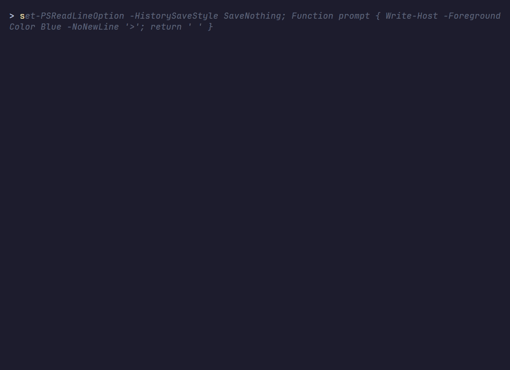

# Lists

```text
schemify list <schema.json> [-o file] [-f json|python|javascript]
```

`list` asks for **items** matching the schema, one after another, until you say **No**.
The result is a list. Each item is asked and checked exactly like [`fill`](fill.md).

```text
$ schemify list person.schema.json -f python -o people.py
Item 1
? First name: Rama
? Last name: Hasan
? Age (In whole years): 25

? Add another item? (1 so far) Yes
Item 2
? First name: Omar
? Last name: Ali
? Age (In whole years):

? Add another item? (2 so far) No
Saved to: .../people.py
```

```python
[{'first': 'Rama', 'last': 'Hasan', 'age': 25},
 {'first': 'Omar', 'last': 'Ali'}]
```



- A list always has **at least one** item.
- The schema describes **one item**, not the list: the same `person.schema.json` works
  for `fill` and `list`.
- The count in `Add another item? (2 so far)` helps on long sessions.

## When to use `list` or an array

| You want | Use |
|----------|-----|
| A file that is a list of records (rows for templify, seed data, test fixtures) | `list` with an item schema |
| A record that contains a list (an invoice and its lines) | `fill` with an `array` property |

templify's `render -s` and qrbar-cli's `render -s` ask with `list` for the default
modes, and with `fill` for one record. See [With other tools](other-tools.md).
